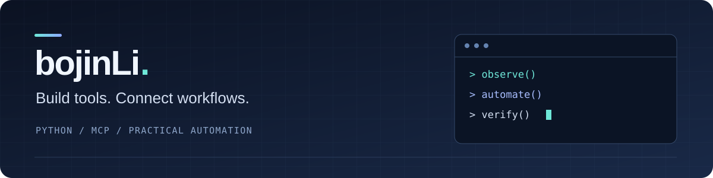

  <b>Python · MCP · Windows Automation · Scientific Computing</b> 
  把重复操作整理成可复用的工具，把分析过程变成可追溯的结果。

## Hi, I'm bojinLi 👋

I build tools that connect AI assistants with desktop software and turn recurring tasks into reusable workflows. My public projects focus on **MCP integrations**, **Python scientific computing**, and **Codex skills**.

我关注 AI 与本地软件之间的实际连接：从桌面界面控制、数据处理，到可复用的技能工作流。下面是我的两个原创开源项目。

## Featured projects

| Project | What it does | Built with |
| :--- | :--- | :--- |
| **[JADE Research MCP](https://github.com/bojinLi/jade-research-mcp)** | Connects AI assistants to MDI JADE 9 on Windows, with a separate engine for powder XRD calculations. 支持界面观察与控制、谱图处理、峰拟合和结果导出。 | Python · MCP · NumPy · SciPy · pymatgen |
| **[免手写作业 Skill](https://github.com/bojinLi/mian-shouxie-zuoye)** | A Codex workflow for turning problems or existing solutions into A4 handwriting-style images. 包含解题核对、分页、配图与成图校对。 | Codex Skills · Markdown · Image generation |

### Inside JADE Research MCP

- **Observe → act → verify.** UI actions use a fresh observation token; results are checked after each step.
- **Two distinct execution paths.** `jade_*` controls the installed application; `xrd_*` performs independent Python calculations.
- **Traceable outputs.** Input hashes, processing parameters, tables, figures, and reports are saved with each analysis.

JADE Research MCP is an independent integration. Its README documents supported environments, setup, validation, and calculation limits.

## Tools I use

| Area | Tools & formats |
| :--- | :--- |
| Integrations | MCP / stdio · Windows desktop automation · Codex Skills |
| Scientific computing | Python · NumPy · SciPy · pymatgen |
| Reusable workflows | Markdown · JSON · PowerShell · Git / GitHub |

## How I build

- **Start with a concrete task.** Make the input, steps, and output clear.
- **Keep results inspectable.** Record parameters and verify what the tool actually produced.
- **Keep private references local.** Use anonymous examples in public repositories.

从实际需求出发，保留可复现的过程，也写清楚工具的适用范围。

---

Found a bug or have a use case? Open an issue in **[JADE Research MCP](https://github.com/bojinLi/jade-research-mcp/issues)** or **[免手写作业 Skill](https://github.com/bojinLi/mian-shouxie-zuoye/issues)**.
